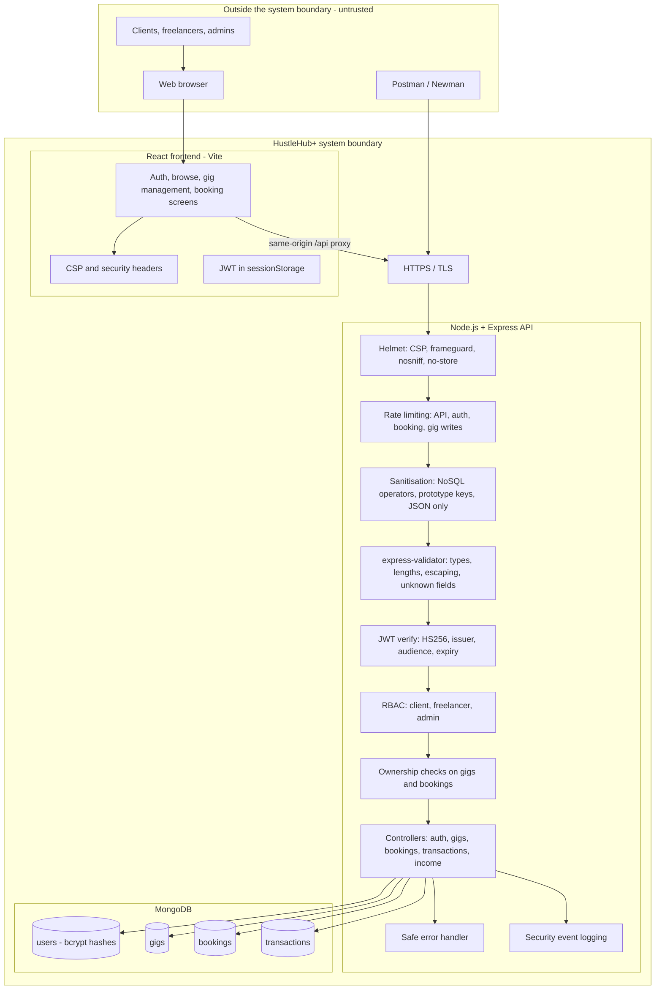
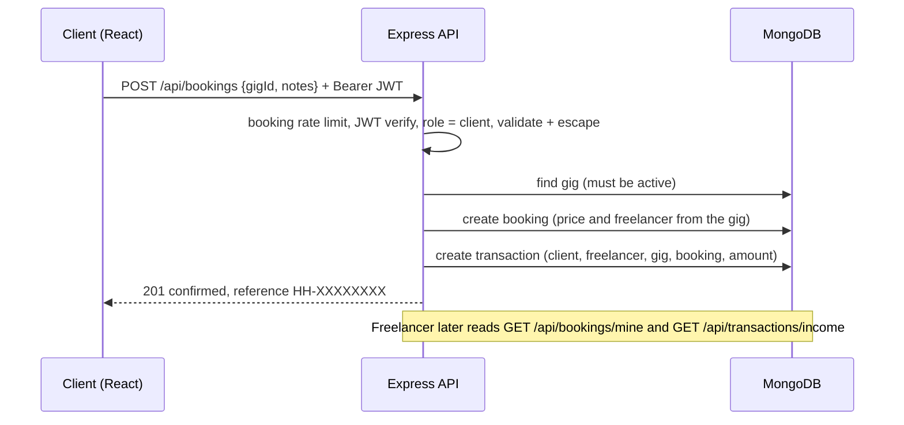
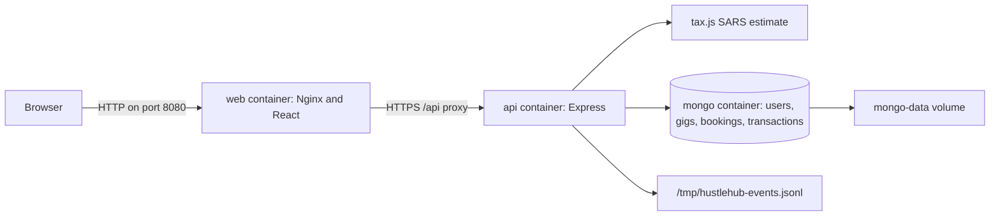
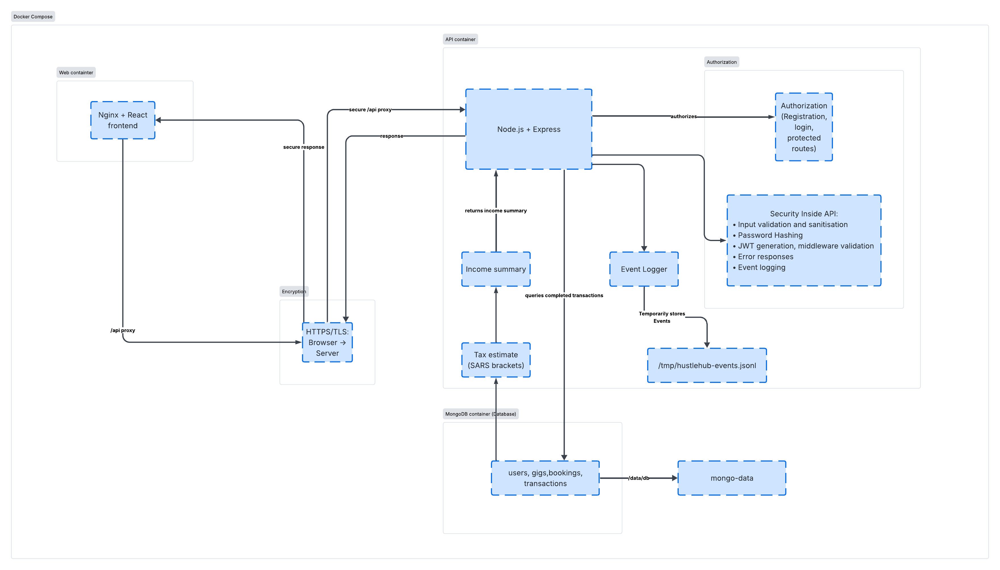

# HustleHub+ architecture (Part 2)

The MERN system with its security controls and system boundaries. GitHub renders this diagram directly; export it to `docs/images/architecture-diagram.png` if the README image needs refreshing.

## Booking flow

# Part 3: containers, tax and logging

Docker Compose runs three containers. The browser talks to the web container. That container serves the React app and proxies `/api` to the API over HTTPS. The API calculates the tax estimate, reads and writes MongoDB, and appends events to a log file (Docker, 2026; SARS, 2026; OWASP, 2025b).

The figure shows the same three containers. The web container is Nginx with the React build. The API container holds the income summary, the SARS tax estimate, the event logger and the security checks. The MongoDB container stores the collections on the `mongo-data` volume. The log file path in the figure is the `LOG_FILE` set by Compose.

Sources for the citations in this file are in the repository README reference list.
